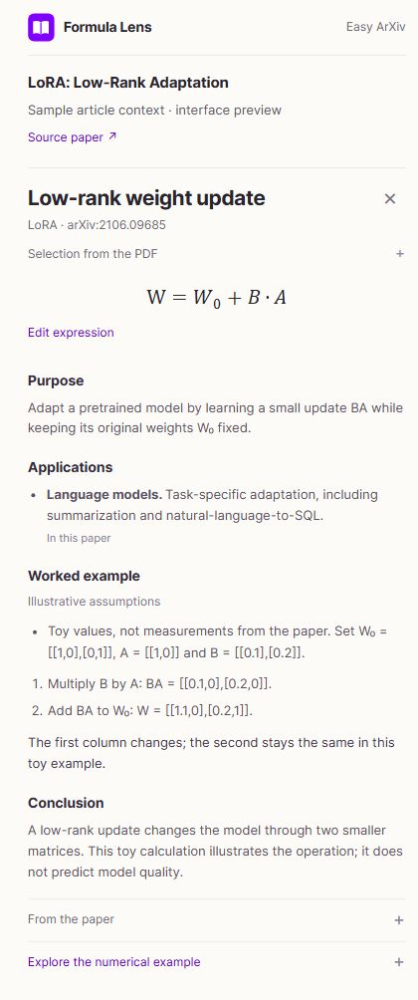

<div align="center">


# Easy ArXiv

**Find your next paper. Understand the ideas.**

Search arXiv, read the original research, and check your understanding with AI Quest.

<p>
  <a href="https://easy-arxiv.pages.dev"><strong>Open Easy ArXiv ↗</strong></a>
  &nbsp;·&nbsp;
  <a href="https://www.producthunt.com/products/easy-arxiv">Product Hunt</a>
  &nbsp;·&nbsp;
  <a href="#run-locally">Run locally</a>
</p>

</div>

---

## From a question to a reading list

| Step | What you can do |
| --- | --- |
| **01 · Discover** | Search by topic, title, paper ID, or arXiv link. Narrow the results with suggestions, dates, and sorting. |
| **02 · Read** | Explore paper details and open the original arXiv PDF. Browse monthly submission statistics along the way. |
| **03 · Understand** | Use **AI Quest** to work through key ideas and quiz questions grounded in a paper. |
| **04 · Return** | Sign in with **ORCID** and keep up to 100 papers in your personal reading list. |

Search, reading, and a prepared AI Quest example are available to guests. Generating a new Quest requires ORCID sign-in and available AI quota. Generated explanations should be checked against the original research.

## Preview · Formula Lens

> An optional Chrome side panel for understanding formulas in the context of a paper.
> **Version 0.3 is a review candidate. Hosted article analysis is disabled and has not been deployed.**

**The website works without installing the extension.** Formula Lens is an additional tool for readers who want to experiment beside a PDF.

The candidate workflow reads the complete PDF first, then explains a selected formula through **Purpose**, **Applications**, **Worked example**, and **Conclusion**. The formula is checked against the full document again; supporting passages and wider applications are distinguished. The interface is in English, with numerical controls closed until needed.

Chrome keeps its native PDF viewer and the original address. A separate expression sandbox already runs supported numerical calculations locally. The article-analysis service requires an explicit action and an ORCID-approved connection; provider keys stay on the server. The current upload transport needs adaptation and runtime profiling for Cloudflare Free before enabling that service. A prepared interface example is labeled as sample content, not a live AI result.

**[Preview and local installation guide](extensions/formula-lens/README.md)** · [Extension source](extensions/formula-lens)

<details>
<summary><strong>See the interface preview</strong></summary>

<p align="center"></p>

</details>

## Run locally

Use **Python 3.10+** from the repository root:

```sh
python -m venv .venv
# Activate .venv for your operating system, then:
python -m pip install -r requirements.txt
python -m uvicorn server:app --host 127.0.0.1 --port 5000
```

Open **http://127.0.0.1:5000**. On Windows, [`run.ps1`](run.ps1) can reuse an existing Python environment.

For optional local Gemini and ORCID settings, copy the empty [configuration template](.env.example) to an ignored `.env`. Local reading lists use SQLite in `data/`.

## Deploy

The live app uses **Cloudflare Pages + JavaScript Functions + D1**. Static pages load independently of external research and AI services; D1 persists reading lists, hashed sessions, caches, and usage quotas. The Python server remains available for local development.

```sh
npm ci
python scripts/build_pages.py
```

Output: `dist`. The build copies an explicit public asset list and bundles the edge API. Provider keys belong in **encrypted runtime secrets**, outside the browser bundle and repository.

**[Deployment walkthrough](deploy/README.md)** · [Cloudflare settings and bindings](cloudflare/README.md) · [D1 schema](cloudflare/d1-schema.sql)

The deployment targets Cloudflare's Free plan. Hosting and Gemini each have finite limits; new AI Quests initially allow 10 generations per account and 100 in total per day.

<details>
<summary><strong>Development checks and safe publishing</strong></summary>

Use **Node.js 24+** for the JavaScript tests, which include SQLite-backed edge checks.

```sh
npm ci
python -m unittest discover -s tests -p "test_*.py"
node --test tests/test_*.mjs tests/test_*.cjs
python scripts/build_pages.py
python scripts/check_public_secrets.py
# Check the exact staged files and history before publishing:
python scripts/check_public_secrets.py --staged --history
```

Keep API keys, OAuth secrets, populated `.env` files, databases, and user data out of Git. Never place credentials in public JSON, frontend code, build substitutions, or screenshots. The scanner reports locations without printing matched values. Revoke any previously exposed credential at its provider; removing a file does not revoke it.

</details>

## Research sources

Search and statistics use official arXiv services. Featured papers and the prepared Quest are examples. Easy ArXiv is an independent project.

Thank you to [arXiv](https://arxiv.org/) for use of its open access interoperability. This service was not reviewed or approved by, nor does it necessarily express or reflect the policies or opinions of, arXiv.
